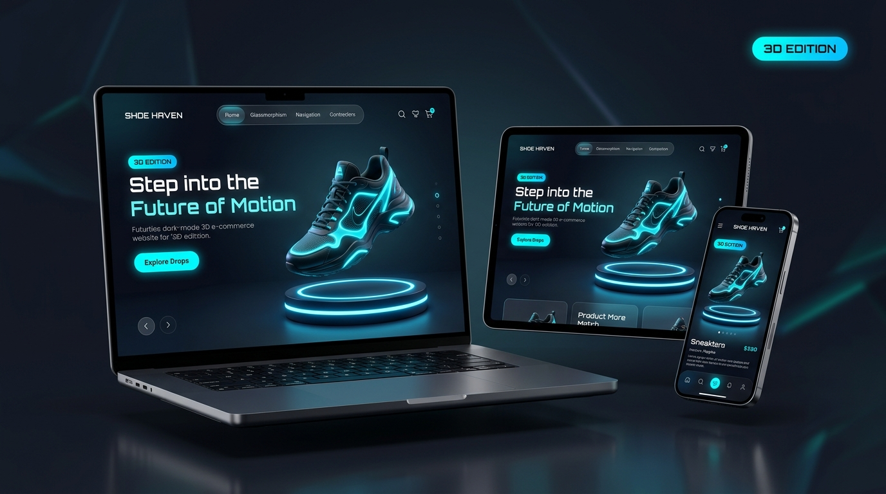

# ⚡ SHOE HAVEN (3D EDITION) — Futuristic Spatial Footwear Atelier

<p align="center">
  
</p>

<p align="center">
  <strong>Step into the Future of Motion</strong> — A modern, high-converting, fully responsive spatial 3D e-commerce experience engineered for futuristic footwear.
</p>

<p align="center">
  
  
  
  
  
  
</p>

---

## 🌟 Overview

**SHOE HAVEN (3D EDITION)** is a luxury e-commerce web application that merges cutting-edge spatial WebGL 3D rendering with an Apple-tier glassmorphism aesthetic and cyberpunk-inspired neon accents. 

Built with zero heavy framework bloat, the platform runs instantly in any browser via vanilla JavaScript, Tailwind CSS, and Three.js, delivering a fluid 60 FPS interactive product showcase across desktops, tablets, and smartphones.

---

## ✨ Key Features

### 🎮 1. Interactive 3D WebGL Sneaker Showcase
* **Floating 3D Sneaker Geometry**: Real-time procedural 3D sneaker mesh featuring sculpted nitrogen-infused cushioning, aerodynamic upper body, contoured toe box, and illuminated neon piping.
* **Dual-Ring Glowing Pedestal**: Stepped dark metallic pedestal embedded with dual concentric neon rings casting dynamic illumination upward onto the sneaker.
* **360° Orbital Control**: Full mouse drag and touch rotation with smooth inertial damping.
* **Interactive Lighting Rig**: Cursor light tracker projects real-time specular reflections onto materials as the user hovers over the canvas.
* **Dynamic Colorway Switcher**: Real-time switching between 4 glowing palettes:
  * 🩵 **Cyber Cyan** (`#00E5FF`)
  * 🧡 **Solar Orange** (`#FF6B00`)
  * 💜 **Neon Purple** (`#A855F7`)
  * 💚 **Emerald Green** (`#10B981`)

### 💎 2. Futuristic Glassmorphism Design System
* **Deep Cosmic Void Palette**: `#0B0F19` to `#030712` background with subtle ambient radial blooms and floating stardust particles.
* **Floating Glass Pill Navbar**: Desktop navigation pill centered at the top with glowing brand logo, `3D EDITION` badge, menu links, and animated badges.
* **3D Perspective Cards**: Product tiles with realistic cursor tilt (`perspective: 1000px`), glowing neon borders, and floating shoe elevation on hover.

### 📱 3. Pixel-Perfect Mobile Ergonomics (< 768px)
* **Single-Column Responsive Stack**: Balanced typography (`text-3xl` to `text-6xl`) with zero horizontal overflow or awkward word breaking.
* **Adaptive 3D Camera**: Automatically recalibrates focal distance (`camera.position.set(0, 0.45, 6.2)`) to frame the sneaker and pedestal on narrow mobile viewports.
* **Anchored Glass Bottom Dock**: Pinned flush to the screen bottom (`position: fixed; bottom: 0`) with iOS/Android safe area inset support (`env(safe-area-inset-bottom)`).
* **Collapsible Slide-Down Menu**: Streamlined mobile header (Logo + Bag + Hamburger) with an animated dropdown sheet for collections.

### 🛍️ 4. Full E-Commerce Journey
* **Data-Driven Catalog (`data/products.js`)**: Dynamic rendering of Men's, Women's, and Junior categories with instant multi-facet filter chips (Casual, Formal, Sports, Party), real-time search, and price sorting.
* **3D Quick View Modal**: Modal overlay showcasing 3D product details, sizing selector, rating scores, and instant "Add to Bag".
* **Off-Canvas Slide-In Glass Bag**: Persistent drawer accessible from all pages with live quantity increment/decrement, tax calculation, and free shipping progress.
* **Interactive 3D Credit Card Checkout**: 3D card simulator on [checkout.html](checkout.html) that live-mirrors card numbers, cardholder names, and expiry dates in 3D space.
* **Curated Wishlist**: Saved shoes gallery on [wishlist.html](wishlist.html) with 1-click "Move to Bag" actions.

### 🎨 5. Universal Vector Favicon Suite
* High-DPI vector SVG favicon (`favicon.svg`) with cyan glowing sneaker silhouette.
* Multi-resolution binary `favicon.ico` (16x16, 32x32, 48x48, 64x64).
* Apple Touch Icon (`images/apple-touch-icon.png`) for iOS/Android home screens.

---

## 📁 Project Architecture

```
D:\Projects\Ecommerce-Website\
├── 📄 index.html                     # 3D Kinetic Hero, Three.js Canvas, Ticker, Bento Grid
├── 📄 product.html                   # Dynamic catalog with instant search & 3D quick view
├── 📄 cart.html                      # Luxury bag workspace with promo discounts (HAVEN20)
├── 📄 checkout.html                  # 3D holographic credit card simulator & order telemetry
├── 📄 wishlist.html                  # Saved item gallery with 1-click "Move to Bag"
├── 📄 IMPLEMENTATION_PLAN.md         # Full architectural design & implementation guide
├── 📄 README.md                      # Comprehensive project documentation
├── 📄 favicon.ico                    # Multi-resolution binary favicon (16/32/48/64)
├── 📄 favicon.svg                    # Scalable high-definition vector tab icon
├── 📁 css/
│   └── 🎨 style.css                  # Kinetic Design System (tokens, glassmorphism, 3D tilt)
├── 📁 js/
│   ├── ⚙️ app.js                     # Reactive store, offcanvas cart drawer, toasts & quick-view
│   ├── 🎮 three-hero.js              # Three.js 3D sneaker mesh, pedestal & orbit controls
│   └── 🔌 script.js                  # Legacy bridge script
├── 📁 data/
│   └── 📦 products.js                # Structured product catalog dataset with 3D metadata
└── 📁 images/
    ├── 🖼️ shoe_haven_responsive_3D.jpg # Responsive device showcase banner
    ├── 🖼️ Logo.webp                  # Glowing brand icon
    ├── 🖼️ favicon.svg                # Vector tab icon
    ├── 🖼️ apple-touch-icon.png       # 180x180 iOS home screen icon
    ├── 📁 Shoe img/                  # High-definition video loop (4380323-hd_...mp4)
    └── 📁 Category/                  # 37 curated high-resolution photography assets
        ├── 📁 Men's Category/        # Casual, Formal, Sports
        ├── 📁 Womens Category/       # Casual, Formals, Sports
        └── 📁 Kids Category/         # Formal, Party, Sports
```

---

## 🛠️ Technology Stack

| Layer | Technologies |
| :--- | :--- |
| **Markup & Structure** | HTML5 Semantic Elements, Accessible ARIA Attributes |
| **Styling & System** | Tailwind CSS CDN, Custom CSS3 Custom Properties, Backdrop Filters |
| **3D & WebGL Engine** | [Three.js (r128)](https://threejs.org/) with ACES Filmic Tone Mapping |
| **State Management** | Vanilla JavaScript Reactive Store (`localStorage` persistence, CustomEvents) |
| **Typography** | Google Fonts: **Space Grotesk** (Headings) & **Inter** (Body) |
| **Icons** | [Bootstrap Icons (v1.11.3)](https://icons.getbootstrap.com/) |

---

## 🚀 Getting Started

### 1. Clone the Repository
```bash
git clone https://github.com/IsravelTECH/Shoe-Haven.git
cd Shoe-Haven
```

### 2. Run Locally
Because the project uses standard web technologies with dynamic client-side rendering, no heavy build or `npm install` is required:

* **Option A (Direct File)**: Double-click `index.html` to open it in Chrome, Edge, Safari, or Firefox.
* **Option B (VS Code Live Server)**: Right-click `index.html` in VS Code and select **"Open with Live Server"**.
* **Option C (Local HTTP Server)**:
  ```bash
  # Using Python
  python -m http.server 3000

  # Or using Node.js
  npx serve .
  ```
  Then navigate to `http://localhost:3000`.

---

## 🏷️ Test Coupons & Shortcuts
* **Promotional Code**: Enter `HAVEN20` in the Shopping Bag ([cart.html](cart.html)) for an instant **20% discount**.
* **Filter Hashes**: Direct URLs for quick filtering:
  * `product.html#men` — Filters Men's collection
  * `product.html#women` — Filters Women's collection
  * `product.html#kids` — Filters Junior collection
  * `product.html#sports` — Filters Nitro Sports series

---

## 📜 License
This project is open-source and available under the [MIT License](LICENSE).

---

<p align="center">
  Engineered with 🩵 for Spatial Web E-Commerce.
</p>
